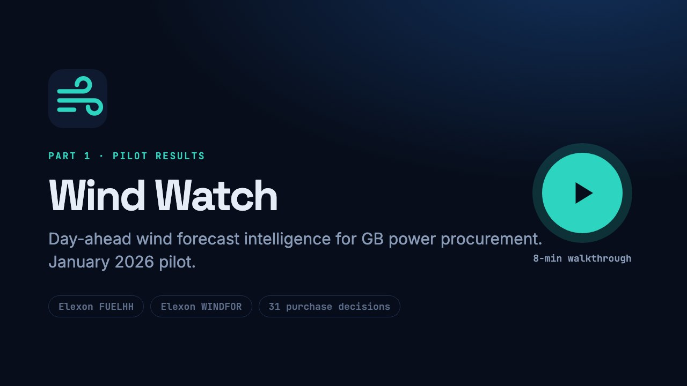
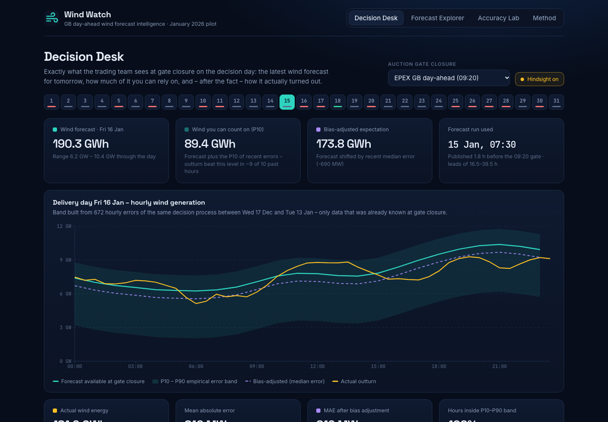
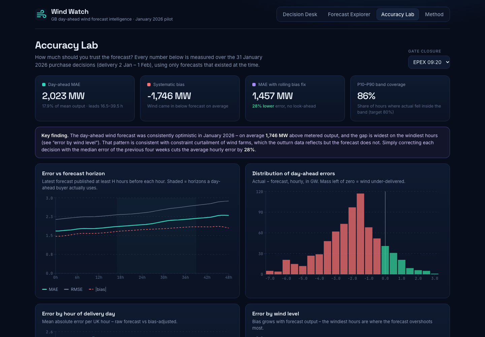
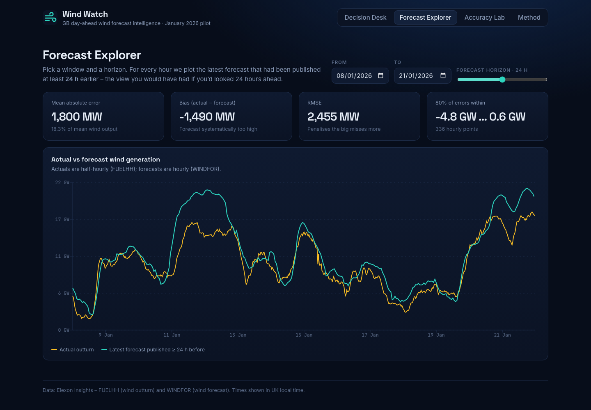
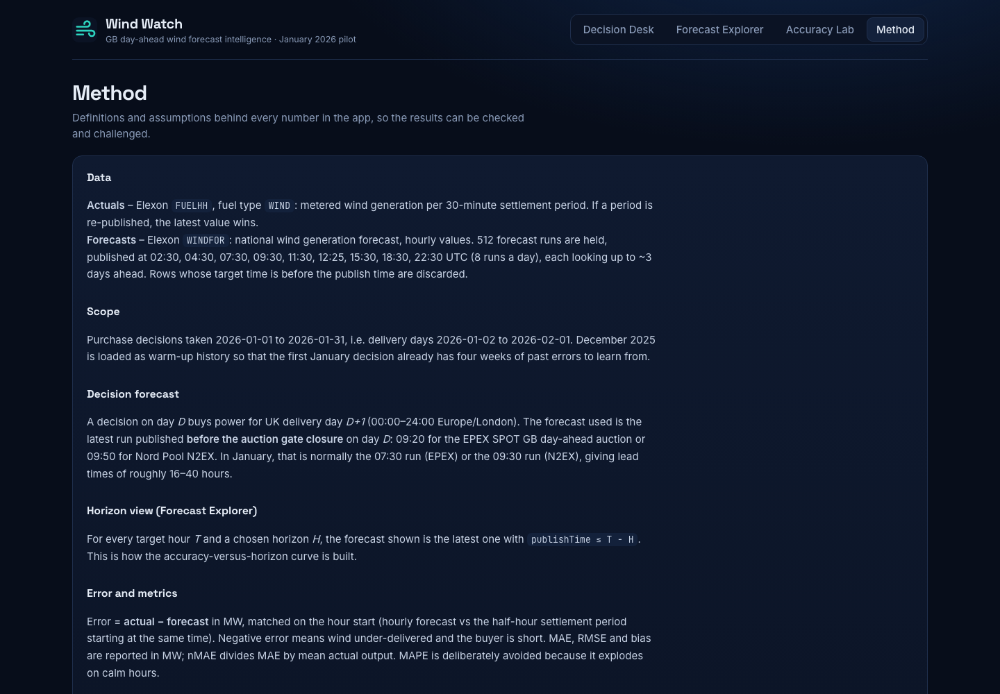
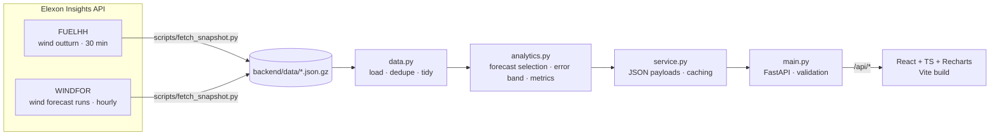

<div align="center">


# Wind Watch

**Day-ahead wind forecast intelligence for GB power procurement – January 2026 pilot**

React · TypeScript · FastAPI · pandas · Docker · Vercel

[▶ Watch the demo](#-video-walkthrough) · [🌐 Live app](https://ww-an.vercel.app) · [📊 Analysis](docs/ANALYSIS.md) · [⚙ Run it](#-running-it)

</div>

---

## 🎬 Video walkthrough

[](docs/media/wind_watch_demo.mp4)

> **[▶ Play the walkthrough (7 min 49 s, MP4)](docs/media/wind_watch_demo.mp4)**
>
> | | Part | Audience | Starts at |
> |---|---|---|---|
> | 1 | Pilot results: portal walkthrough and findings | Client trading team | 0:00 |
> | 2 | Architecture, method, code base and practices | Tech lead review | 3:54 |

## 🌐 Live app

### **[ww-an.vercel.app](https://ww-an.vercel.app)**

Frontend and API are served from the same Vercel deployment (API: [`/api/meta`](https://ww-an.vercel.app/api/meta)).

The app opens on the Decision Desk. Pick any January decision day, then click **Reveal actuals**.

---

## The problem in one line

Every morning, before the **09:20 EPEX** (or 09:50 N2EX) day-ahead gate closes, the trading desk must decide how much
power to buy for tomorrow on top of what wind will provide. Wind Watch shows **what the latest forecast says**,
**how far it can be trusted**, and **how it actually turned out**.

## What we found (January 2026)

| | |
|---|---|
| Day-ahead forecast MAE | **2,023 MW** (17.9 % of mean wind output) |
| Systematic bias | **−1,746 MW**: wind under-delivered on **27 of 31** days |
| Bias on the windiest hours (forecast > 16 GW) | **−2.8 GW**, consistent with constraint curtailment |
| Error after a rolling, no-look-ahead bias fix | **1,457 MW (−28 %)** |
| P10–P90 band coverage | **86 %** of hours (nominal 80 %) |
| Worst day | 28 Jan delivery: 267 GWh forecast, 139 GWh actual (**−48 %**) |

The full write-up is in [docs/ANALYSIS.md](docs/ANALYSIS.md).

## Screens

| Decision Desk | Accuracy Lab |
|---|---|
|  |  |
| **Forecast Explorer** | **Method** |
|  |  |

- **Decision Desk**: for a chosen decision day and auction, shows the forecast run available at gate closure, a P10–P90
  band built only from errors already known that morning, a bias-adjusted expectation, how the forecast evolved over
  the previous 48 h of runs, and, with hindsight switched on, the actual outturn.
- **Forecast Explorer**: any window, any horizon from 0 to 48 h. For each hour it plots the latest forecast published at
  least *H* hours earlier.
- **Accuracy Lab**: error against horizon, error distribution, error by hour and by wind level, and a scorecard for every January decision.
- **Method**: every definition and assumption, written down.

---

## 🧱 Architecture



- **Snapshot, not live calls.** The two Elexon streams are pulled once into gzipped JSON (about 230 kB) and committed,
  so the demo never depends on Elexon being reachable. Run `python -m scripts.fetch_snapshot` to refresh.
- **Pure analytics core.** `analytics.py` is made of plain functions on DataFrames with no I/O, so it's easy to unit-test.
- **Thin HTTP layer.** `main.py` only validates input (January scope, real auction gates, range limits) and delegates.
- **One container.** The Docker image builds the UI with Node, then serves the API and static files from a slim
  Python image. On Vercel, the same FastAPI app runs as a Python function next to the static build.

### Key definitions

| Term | Definition |
|---|---|
| Decision forecast | Latest `WINDFOR` run with `publishTime` before gate closure on day *D*, cut to UK delivery day *D+1* (Europe/London, DST-aware). EPEX 09:20 → 07:30 UTC run, leads 16.5–39.5 h |
| Horizon view | For target hour *T* and horizon *H*: latest forecast with `publishTime ≤ T − H` (one `merge_asof`) |
| Error | `actual − forecast` in MW. Negative means wind under-delivered and the buyer is short |
| Error band | P10 / P50 / P90 of the previous 28 decisions' hourly errors, admitting only decision days ≤ *D − 2* (delivery finished), so **no look-ahead** |

---

## 📁 Repository layout

```
.
├── api/
│   └── index.py              Vercel serverless entry: re-exports the FastAPI app
├── backend/
│   ├── app/
│   │   ├── config.py         scope (Jan 2026), gate times, paths, UK timezone
│   │   ├── elexon.py         Elexon FUELHH / WINDFOR stream client (chunked, retried)
│   │   ├── data.py           snapshot loading, de-duplication, tidy frames
│   │   ├── analytics.py      forecast selection, error band, metrics (pure functions)
│   │   ├── service.py        builds API payloads, caches decision history per gate
│   │   └── main.py           FastAPI routes + SPA static serving for Docker
│   ├── data/                 fuelhh_wind.json.gz, windfor.json.gz (Dec 2025 – 2 Feb 2026)
│   ├── scripts/
│   │   └── fetch_snapshot.py refreshes the data snapshot from Elexon
│   ├── tests/                pytest: analytics rules + API contract
│   ├── requirements.txt
│   └── requirements-dev.txt
├── frontend/
│   ├── src/
│   │   ├── api.ts            typed API client mirroring backend payloads
│   │   ├── format.ts         UK-time and unit formatting helpers
│   │   ├── components/ui.tsx Card, Kpi, Legend, tooltip, useAsync hook
│   │   ├── pages/            DecisionDesk, Explorer, AccuracyLab, Method
│   │   ├── App.tsx           shell + hash-based tabs
│   │   └── styles.css        theme
│   ├── index.html
│   ├── package.json
│   └── vite.config.ts        dev proxy /api → :8000
├── docs/
│   ├── ANALYSIS.md           findings and recommendations
│   └── media/                demo video, poster, screenshots
├── .github/workflows/ci.yml  tests · UI build · Docker smoke test
├── Dockerfile                multi-stage: Node build → Python runtime
├── docker-compose.yml
├── vercel.json               static build + Python function routing
├── heroku.yml                container deploy alternative
└── requirements.txt          Python deps for the Vercel function
```

---

## ⚙ Running it

### Option 1: Docker (recommended)

```bash
docker compose up --build
```

Open http://localhost:8000. The API docs are at http://localhost:8000/docs.

### Option 2: local development

Backend (Python 3.11+):

```bash
cd backend
python -m venv .venv && source .venv/bin/activate
pip install -r requirements-dev.txt
uvicorn app.main:app --reload --port 8000
```

Frontend (Node 20+), in a second terminal:

```bash
cd frontend
npm install
npm run dev
```

Open http://localhost:5173. Vite proxies `/api` to the backend.

### Tests

```bash
cd backend && pytest -q
```

### Refresh the data snapshot

```bash
cd backend && python -m scripts.fetch_snapshot
```

### API

| Endpoint | Purpose |
|---|---|
| `GET /api/health` | liveness |
| `GET /api/meta` | scope, gates, forecast run schedule |
| `GET /api/decision?day=2026-01-15&gate=09:20` | decision-desk payload for one decision day |
| `GET /api/series?start=2026-01-08&end=2026-01-21&horizon=24` | actual vs forecast at a horizon |
| `GET /api/accuracy/horizons` | MAE / RMSE / bias for horizons 0–48 h |
| `GET /api/accuracy/decisions?gate=09:20` | January decision scorecard, by hour, by wind level, histogram |

---

## 🚀 Deployment

**Vercel**: import the repo with no settings to change. `vercel.json` builds `frontend/` to static files and
deploys `api/index.py` as a Python function that serves `/api/*`.

```bash
npx vercel --prod
```

**Heroku**: container stack via `heroku.yml`:

```bash
heroku stack:set container && git push heroku main
```

## 🛠 Development practices

- Small, scoped commits that follow the build order: data, analytics, API, UI, delivery.
- Business rules (gate closure, no look-ahead, DST, sign convention) are pinned by unit tests.
- Input validation at the edge; pure functions in the core; caching where the work is repeated (`lru_cache` per gate).
- CI on every push: backend tests, frontend type-check and build, Docker build and smoke test.
- All assumptions are documented in the app's **Method** tab and in [docs/ANALYSIS.md](docs/ANALYSIS.md).

## Limitations and next steps

- Wind only, by design of the pilot. Adding demand and solar would let the app output a purchase volume directly.
- One month is a small sample. Next steps are a back-test across seasons and a wind-level-aware (quantile) error model.
- Scheduled snapshot refresh (cron or GitHub Action) for live use.

---

<sub>Built by Anmol Adwani · Data source: Elexon Insights (BMRS) FUELHH and WINDFOR datasets.</sub>
